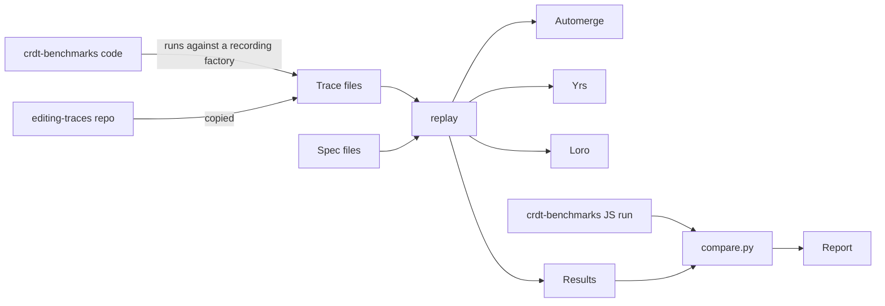

# A Guide to the crdt-benchmarks Replay

This guide explains what the replay does, why it works in this way, and what you can
conclude from its results. Read this first. [replay.md](replay.md) is the reference for
flags, formats, and details.

You need to know what a CRDT is. You do not need to know this code.

## The question

[crdt-benchmarks](https://github.com/dmonad/crdt-benchmarks) is a well-known benchmark
suite for CRDT libraries. It runs JavaScript and WebAssembly builds. Replicant studies the
Rust libraries: Automerge, Yrs, and Loro.

So we want to run the same workloads on the Rust libraries, and we must answer one
question first: **are these results comparable with the published ones?** If the replay
agrees with crdt-benchmarks where it should, we can trust it where crdt-benchmarks has no
answer.

The replay and its comparison, called the calibration, answer that question.

## How it works



1. **Record.** `just gen-traces` runs the unmodified benchmark code against a fake CRDT
   library that records each call. The result is a trace: a list of what each writer does,
   and what it has seen. So all libraries get exactly the inputs of crdt-benchmarks.
2. **Replay.** `just replay` applies each trace through an adapter for each library, and
   times it. The tool moves updates between replicas itself, so each replica has the exact
   state that the trace names.
3. **Check.** At the end, the tool checks the content. A wrong result is an error, and that
   trial reports no time. crdt-benchmarks checks less than this.
4. **Compare.** `just calibrate` also runs the JS suite, and `compare.py` prints a report.

The trace files are not in this repository. See [Getting the traces](#getting-the-traces).

## The benchmarks

N is 6000.

| Group | What it tests | Writers | What is timed |
|---|---|---|---|
| B1 (11 workloads) | One writer does N edits, such as append, prepend, or random inserts. A second replica receives them. | 1 | All edits and the delivery |
| B2 (4 workloads) | Two writers each make a batch of edits after a shared setup. | 2 | The edits and the delivery |
| B3 (4 workloads) | Many writers each make one concurrent edit. | 1540 (20√N) | One replica merging all updates |
| B4 | One person's real editing session, which wrote a research paper. | 1 | All edits |
| B4x100 | B4, repeated 100 times on one document. It reached about 11.6 GB of memory. | 1 | All edits |

The suite has two extra forms of work:

- **`b2.xc`:** crdt-benchmarks syncs each B2 batch at once, so its second batch follows the
  first, and nothing is truly concurrent. The `c` forms hold the same ops, but both batches
  start from the setup. crdt-benchmarks describes this form but does not run it.
- **`et.friendsforever` and `et.clownschool`:** real traces of people who type at the same time.

B3.2 does not run. It writes an object value, and the op model of Replicant has none. An
object value would not make this comparable, because the JS factories do different work
for it: Automerge makes a nested CRDT object, and Yjs and Loro store a plain value.

### The 1540 writers in B3

The writers of B3 are real library documents in one process. They are not fake. Each one
makes its edit outside the timer, and then the timer covers one replica merging them all.
crdt-benchmarks also runs them in one process.

So B3 tests how a library merges work from many writers. It does not test a network or a
sync protocol. It cannot run on containers unless you start 1540 replicas, so that lane
reports it as skipped.

## Replicant has two ways to measure

| | Replay | Orchestrator |
|---|---|---|
| Asks | How fast is the library, on a fixed input? | How does a cluster behave and converge? |
| Writes come from | Recorded traces | Seeded random streams |
| Updates move by | The driver, directly | The real sync protocol |
| Replicas are | In process, or on containers | In process, on containers, or on Kubernetes |

This guide covers the replay only. A replay result says nothing about a sync protocol.

## Why client ids matter

Each library gives each replica an id, and uses it to break ties between concurrent edits.
The libraries choose random ids by default. A benchmark wants repeatable runs, so the
replay sets the ids itself. This choice changed the results more than we expected.

The first version used small, ascending ids:

| B3.4 result | Ascending ids | Seeded ids | JS |
|---|---|---|---|
| Yrs merge time | 44 ms | 23 ms | 27 ms (ywasm) |
| Loro snapshot size, against JS | 0.532 | 1.020 | 1 |

So the replay now uses **seeded** ids. They look random, like real ids, but each run with
one seed gives the same ids. `--id-seed` chooses the seed.

There is one exception. On Yrs, the `friendsforever` trace reaches its expected text only
with some id orders. It fails with seeds 1 and 2, and passes with seed 3. So its spec names
ascending ids. This is a property of the trace and of the YATA algorithm. Real Yjs fails in
the same way with descending ids. It is not an error in the replay.

### Automerge and actor order

Automerge keeps its ids, which it calls actors, in a sorted table. If a new actor does not
go at the end of the table, Automerge renumbers the existing ops. So random actors cost more
than ascending ones: 37% on B3.4 and 28% on B3.5. Seeded times do not depend on the
adapter's own bootstrap actor, so you can quote them. See
[replay.md](replay.md#automerge-actor-order) for the test.

## What the calibration found

These results are from one host (`Artemis`, macOS, aarch64) at commit `45f699cc`, with seed 1.
The JS side has 5 runs on Node 20.20.2.

### Agrees

Document size is the clearest result. Size does not depend on the speed of the host.

| Replay size / JS size | Automerge | Yrs | Loro |
|---|---|---|---|
| B1 | 0.997-1.000 | 1.000 | 0.993-1.018, except below |
| B2 | 0.998-1.000 | 1.000 | 0.998-1.010 |
| B3 | 0.999-1.000 | 0.952-1.078 | 1.020-1.039 |
| B4 | 1.000 | 1.000 | 0.996 |

Update bytes also agree on B1: Yrs within about 1.1%, Loro within 0.5%, and Automerge within
2.5%. Yrs is exactly 1.000 on B2.

### Does not agree

The ranking of the three libraries by time agrees on **9 of 16** benchmarks. Each case that
differs has a likely reason:

| Benchmark | Reason |
|---|---|
| B1.4, B1.11, B3.1, B3.3 | Loro is about 3 to 5 times slower in JS than in Rust, so it moves up in the Rust ranking. |
| B1.7, B2.3 | Near ties: 40 and 39 ms, and 152 and 154 ms. These can flip between runs. |
| B4 | The three JS values are within 12% of each other. |

### Not explained

- Loro is 7.4% and 5.8% larger than JS on B1.10 and B1.11. Ids are not the cause.
- Yrs is 7.8% larger on B3.1 and 4.8% smaller on B3.4. On B3.3, its size changes with the seed.
- Yrs matches ywasm on B2, but is 1.2 to 3.5 times faster on B1. Yjs is about 6 times faster than Yrs on B2.4.

## What you can quote

**You can quote these.** Name the host, the versions, and the seed.

- Document sizes on B1, B2, and B4, and that they agree with crdt-benchmarks.
- Times and rankings among the three Rust libraries, in one run on one host, if the values are not near ties.
- B3 times with seeded ids.
- That id order changes Yrs and Automerge merge times, with the tables above.

**Quote these with their limits.**

- B3 sizes for Yrs, which differ by up to about 8% and are not explained.
- Loro sizes on B1.10 and B1.11, which differ by about 7%.
- Seeded results as one sample. Other seeds gave very similar times in B3, but this was tested only on B3.

**Do not quote these.**

| Result | Why |
|---|---|
| Rust time against JS time, as an absolute claim | They are different builds, in different runtimes. Compare ratios. |
| `automerge-wasm` on B2 | Its factory ignores `transact`, so it does 12000 update round trips. It takes 287 s on B2.4, and `automerge` JS takes 0.97 s. This is not an Automerge result. |
| B2 update bytes for Automerge and Loro | The JS factories repeat the first batch. |
| B3 update bytes for Automerge | JS is larger by a fixed amount for each client. The cause was not traced. |
| `memUsed` against `retained_bytes` | `memUsed` measures the JS heap, and it cannot see WASM memory. |
| B4x100 against JS | There is no JS run. |
| Automerge 3.5.0 as a regression from 2.1.10 | B1.1 went from 197 ms to 4005 ms, but the two runs had different setups. This needs its own test. |
| Fixed-id B3 results as a comparison with JS | See [Why client ids matter](#why-client-ids-matter). |

## Read a report

`compare.py` prints four parts:

1. **Run.** The versions, the commit, and whether the tree was clean. Do not use a result with `dirty: True`.
2. **Document size.** The ratio of replay to JS. A value near 1 is what you want.
3. **Time.** The times, and the ranking on each side, with `a`, `y`, and `l` for the libraries, fastest first. A row with no rank has a value below 5 ms, because the JS timer rounds to whole ms.
4. **Total update bytes.** The same ratio, for the bytes sent between replicas.

Discard the first trial of each workload as a warm-up. `compare.py` does this.

## Run it yourself

```sh
just gen-traces ../crdt-benchmarks.git   # Once. See below for the other way.
just replay --trials 6 --out results/replay/suite.jsonl
just calibrate ../crdt-benchmarks.git    # Also runs the JS side. It takes a long time.
```

Run both sides of a comparison on one host, with no other heavy work.

## Getting the traces

The traces are not in git. There are two ways to get them:

- **Generate them.** `just gen-traces <clone>` needs a crdt-benchmarks clone at the pinned commit, npm, and access to GitHub. It gives byte-identical files.
- **Download the archive.** `just fetch-traces` downloads `replicant-traces-v1.tar.gz` (2.5 MB) from the `traces-v1` release, and unpacks it to `traces/`. CI uses this. The Zenodo DOI goes here when it is published.

Either way, each spec holds the SHA-256 of each trace, and a replay stops if a hash differs.

## Words

| Word | Meaning |
|---|---|
| Actor, client id, peer id | The id of a writer. Automerge, Yrs, and Loro use these three names. |
| Adapter | The code that gives one library the common `CrdtAdapter` interface. |
| Bootstrap actor | A fixed Automerge actor. All replicas use it to make the same shared object, with no sync. |
| Calibration | The comparison of the replay with crdt-benchmarks. |
| Check | The test of the final content. A trial that fails it reports no time. |
| Lane | Where the replicas run: in process, or remote over gRPC. |
| Replica | One copy of a document. |
| Spec | A TOML file that says how to run a trace, and holds its hash. |
| Trace | A recorded list of edits, and what each writer has seen. |
| Trial | One timed run of one workload on one library. |
| Update | The bytes that a library sends so that another replica can apply its edits. |
