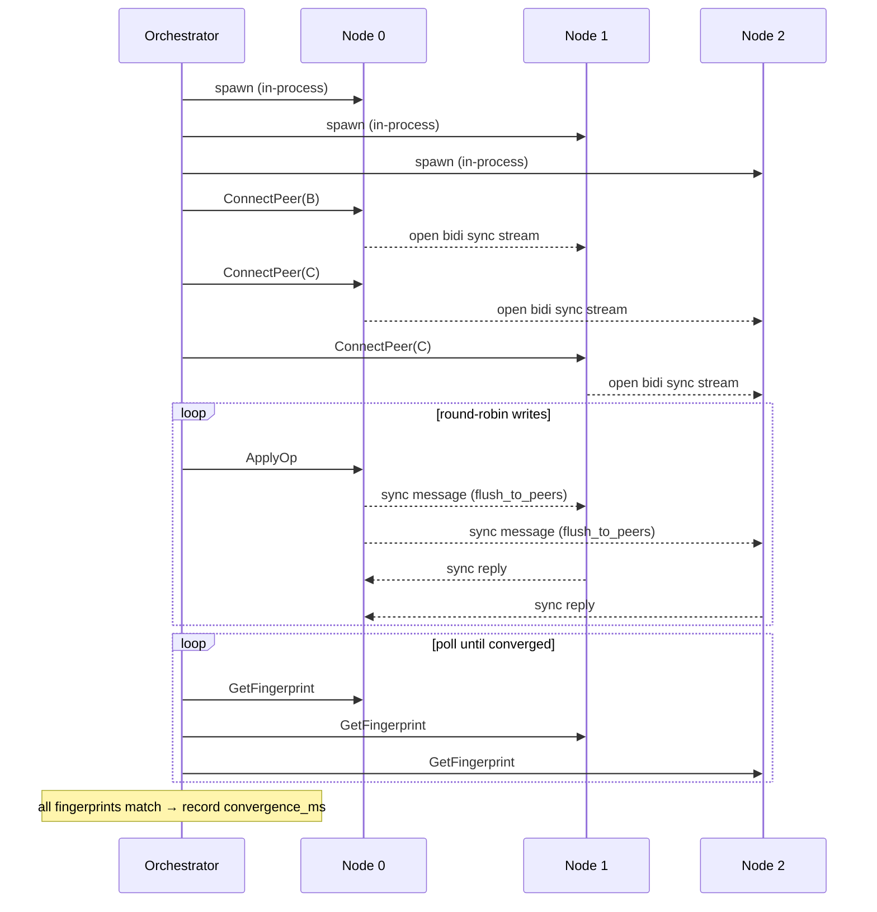
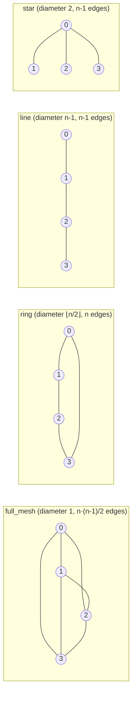
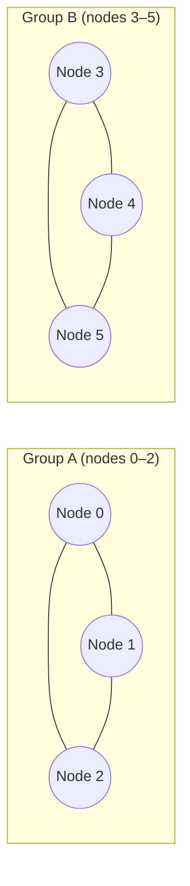
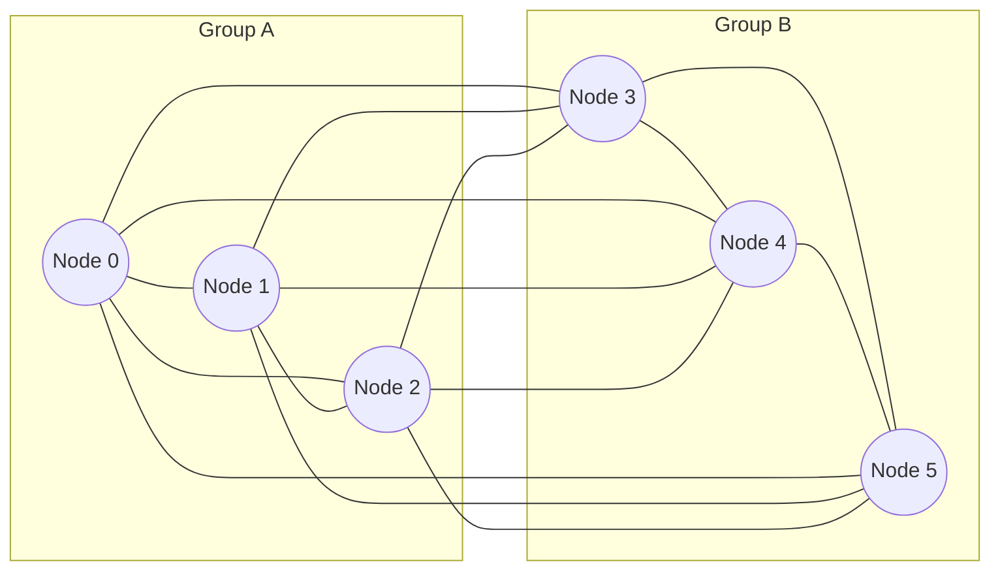
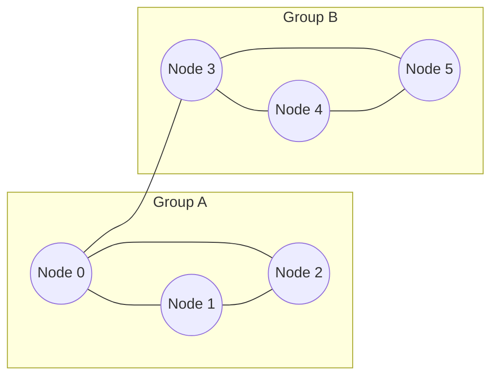
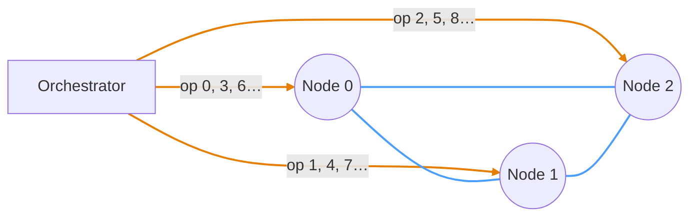
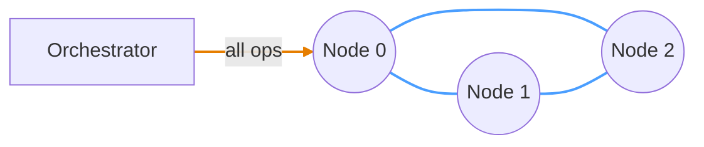

# Scenarios

A scenario is one TOML file under [`scenarios/`](../scenarios/). It sets the
node count, the topology, the write pattern, the workload, and the number of
ops. The orchestrator runs each file as one scenario and measures
`convergence_ms`.

This document describes the scenario fields and how the orchestrator runs them.
The offline-divergence sweep has its own document:
[`divergence-sweep.md`](divergence-sweep.md).

## Orchestration flow

By default, the orchestrator runs every replica as an in-process Tokio task.
With `--replicas`, it connects to replicas that already run elsewhere, for
example the docker compose stack.

Each replica exposes two gRPC services:

- `Replica` for control-plane RPCs.
- `Sync` for peer-to-peer CRDT sync streams.

## Topologies

The `connections` field in `[topology]` sets the graph:

- `connections = "full_mesh" | "ring" | "line" | "star"` selects a named
  topology.
- `connections = { edges = [[0,1], ...] }` sets a custom graph.

After each merge, `recv_loop` relays the inbound state to all other connected
peers. Thus non-mesh topologies converge through intermediate hops.

## Partition-heal

A `[partition_heal]` scenario splits the nodes into groups. Each group is fully
connected inside. Each group writes on its own, so the groups diverge. The heal
step then connects the groups. `convergence_ms` starts at the heal.

The partition is simulated at the application layer:

1. The orchestrator wires the **full post-heal topology** before the writes.
2. It blocks the cross-group links. A blocked link drops traffic in both
   directions, but its stream stays open.
3. The heal unblocks the links and starts the sync handshake.

Thus connection setup stays out of the measured window. For the reason, see
[`metrics.md`](metrics.md#wiring_ms-the-residual-setup-inside-the-window).

The `heal_topology` field sets which edges the heal adds:

- **`"full_mesh"`** (default, can be omitted): one edge for each cross-group
  pair. The post-heal graph is `K_n`.
- **`"bridge"`**: one edge only, between `groups[0].nodes[0]` and
  `groups[1].nodes[0]`. This requires exactly 2 groups.

**Partitioned (writes in progress):**

**After `heal_topology = "full_mesh"`:** all cross-group edges are added.

**After `heal_topology = "bridge"`:** one edge, between `groups[0].nodes[0]`
and `groups[1].nodes[0]`.

The bridge sends all cross-partition state through one edge. It has far fewer
cross edges to flood (1, against N²/4 for full mesh). In the n=4 to n=8
scenarios, bridge heal is **7-21× faster** than full-mesh heal. A line
converges faster than a full mesh in steady state for the same reason. See the
"Partition-heal" section of
[`analysis/convergence.ipynb`](../analysis/convergence.ipynb).

## Write patterns

The `write_pattern` field sets which nodes receive the writes. The bundled
scenarios cover both patterns on every topology. Files for `concentrated` have
the `-concentrated` suffix.

**`round_robin`**: ops cycle through all nodes in scope.

**`concentrated`**: all ops go to node 0.

> **Orange** = write op (orchestrator → node) &nbsp; **Blue** = CRDT sync connection (node ↔ node)

## Text workloads

The `workload` field sets what each write does:

- `map_put` (default): a map write. All older scenarios use it.
- `text_splice`: a text insert. It exercises the sequence-CRDT path.

In a partition-heal text scenario, the `locality` field sets where each insert
goes. The position is drawn for each op, against the text length on the
replica that issues it:

- **`append`**: at the end (`pos = len`). This is the low-contention floor.
- **`random_position`**: uniform in `[0, len]`. This exercises positional
  access.
- **`same_region`**: always `pos = 0`. Every op contests the same anchor. This
  is maximal contention.

A seeded PRNG for each replica (SplitMix64) draws the positions. The seed is
`f(cell, replica, trial)`. Thus the op stream is bit-identical across runs and
across CRDT adapters. The run-provenance file records the seeds.

Two mechanisms keep text workloads correct:

- **Shared-object bootstrap** (`Replica.EnsureText`): before the orchestrator
  wires any edge, every replica authors the same bootstrap change (fixed actor,
  time 0). This change creates the text object. Thus all replicas share one
  object identity without a sync.
- **Validity gate** (`Replica.GetTextLength`): after each text trial, the
  runner checks that the final text length equals the total op count on every
  node. This check runs outside the measured window. Equal fingerprints show
  that the replicas agree. Only this check shows that the agreed document
  contains all the work.

## The divergence grid

The `divergence-n2-*` scenarios are a 12-cell grid: {1e2..1e5} ops per side ×
the three localities. Each cell models two replicas that edit offline and then
merge. It is a partition-heal scenario with one node in each group, so
`convergence_ms` is the heal-to-merge time.

A script generates the cells. Do not edit them by hand:

- `just gen-scenarios` writes them.
- `just check-scenarios` fails if a file differs from its generator output.
  `just ci` runs this check.

For what the grid measures and why, see
[`divergence-sweep.md`](divergence-sweep.md).

## Run provenance

`--provenance PATH` writes a JSON provenance record next to the results. It
contains:

- The git commit and a dirty flag.
- The host and the build profile.
- The node source (in-process or external).
- The parameters of each cell.
- The PRNG seed for each (trial, node) pair.
- The achieved contention of each cell (concurrent siblings per anchor). This
  is simulated from the same seeded draws that the runner uses.

`--dry-run` writes the provenance file and runs no trials. The `bench-docker`
and `bench-k8s` recipes write it automatically, as
`results/results-{docker,k8s}.meta.json`.

`run.crdt` names the CRDT library. Read this field on every lane (in-process,
docker, k8s):

- The in-process lane sets it from `--crdt`.
- On an external stack, the orchestrator cannot know the library, because the
  replicas started before it connected. It writes `null`, and the bench
  scripts fill in the value after the run.

Sweeps worth citing are archived, with their provenance files, under
[`data/`](../data/), for example
[`data/divergence-pilot-2026-08-06/`](../data/divergence-pilot-2026-08-06/).
The `results/` directory is gitignored scratch space.
